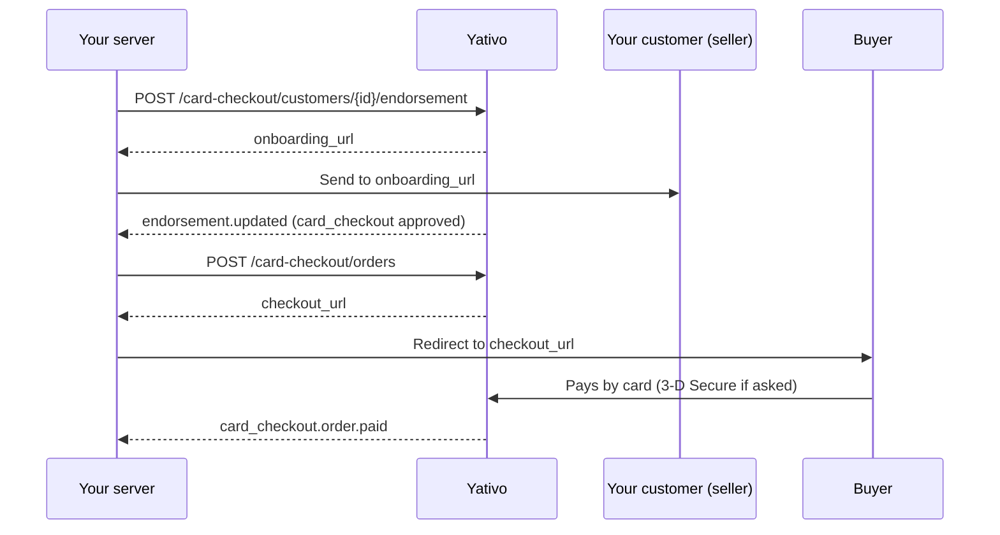

Card Checkout lets the customers on your account accept card payments from their own buyers. You verify each selling customer once, create an order for the amount through the API, and send the buyer to the returned `checkout_url`. Yativo hosts the payment page, runs 3-D Secure when the buyer's bank asks for it, and sends you a webhook for every change in the order.



- You set the amount when you create the order. The buyer can't change it.
- Card details are entered in secure, isolated fields. They never reach your servers.
- **Only the `card_checkout.order.paid` webhook means the buyer paid.** A buyer reaching your `success_url` isn't proof of payment: browsers close, redirects fail and URLs can be typed by hand.

## Before you start

Every request uses your [API key](/yativo-fiat/authentication) (`X-Api-Key` and `X-Api-Secret`), and your Yativo account must have passed KYC. Send an `Idempotency-Key` header on every `POST` so a retried request never runs twice.

- Amounts are decimal strings in major units, for example `"49.99"`.
- Only `USD` is enabled today.
- The status codes on this page are the `status_code` in the response body.

### Request access

Card Checkout must be enabled for your account. Until it is, every other endpoint on this page returns `403` with `code: card_checkout_not_enabled`.

```bash
curl -X POST 'https://api.yativo.com/api/v1/card-checkout/account/request-access' \
  -H 'X-Api-Key: YOUR_API_KEY' \
  -H 'X-Api-Secret: YOUR_API_SECRET' \
  -H 'Idempotency-Key: 7b0f3c52-1e4d-4f7a-9a51-2f6c8d0e4b13' \
  -H 'Content-Type: application/json' \
  -d '{ "note": "We sell online courses to customers in the US and EU." }'
```

`note` is optional (up to 1,000 characters): tell us what your customers sell and to whom. The response is your account with `access_status: "requested"` (`202`). Sending the request again while it's open changes nothing. If access is already enabled you get `200` with `access_status: "enabled"`.

| `access_status` | Meaning |
|---|---|
| `requested` | Waiting for review |
| `enabled` | Approved. Verify the customers who will sell next |
| `declined` | Not approved. Send a new request with more detail |
| `disabled` | Access was turned off. Contact support, or send a new request |

Your pricing (fee, settlement delay, reserve and currencies) is set when access is granted. Read it with [`GET /card-checkout/account`](#your-account-and-balance).

## Step 1: Verify the customers who sell

Each customer that sells by card needs an approved `card_checkout` endorsement, next to its other [endorsements](/yativo-fiat/kyc#track-verification-with-endorsements). Individual and business customers can both be endorsed.

### Submit the endorsement

```
POST /card-checkout/customers/{customer_id}/endorsement
```

No body. Yativo reuses what the customer already submitted:

- **Business customer:** its KYB details (legal name, entity type, tax and registration numbers, registered address and the signer). The customer then uploads company documents on the onboarding page.
- **Individual customer:** its KYC details. If its ID photos and a selfie are already on file they're used straight away. Otherwise the customer confirms the prefilled details and adds the photos on the onboarding page.

```json Response
{
  "status": "success",
  "status_code": 202,
  "message": "Endorsement submitted",
  "data": {
    "customer_id": "4f0c1e1a-8d2b-4c7e-9b1a-3e5f6a7b8c9d",
    "customer_type": "business",
    "endorsement_status": "pending",
    "verification_status": "pending",
    "can_accept_payments": false,
    "onboarding_url": "https://.../onboarding/...?expires=...&signature=...",
    "onboarding_url_expires_at": "2026-11-05T14:00:00+00:00"
  }
}
```

Send the customer to `onboarding_url`. The Yativo-hosted page shows only the form for the customer's type, prefilled with what's on file. If the review needs more, such as a clearer photo, the same page lists each item and collects the answers.

You can also submit it with the endpoint you use for other endorsements: `POST /customer/kyc/resubmit/{customer_id}/card_checkout`. For `card_checkout` it accepts business customers too. Submitting again is safe: an approved customer is left as it is.

<Note>
  If a customer asks for card checkout before your account has access, the request is held, not refused. Yativo files an access request for you, the endorsement becomes `pending` with `metadata.awaiting_business_access: true`, and the response is `202` with `awaiting_business_access: true`. Once your account is enabled, waiting customers are submitted automatically. If your access request was declined, the endorsement returns `403` with `code: card_checkout_access_declined`.
</Note>

### Follow the endorsement

Every change sends the usual `endorsement.updated` [webhook](/yativo-fiat/webhooks). The endorsement also appears on the customer (`GET /customer/{customer_id}`); while the customer has something to do, its `hosted_kyc_url` holds a working onboarding link. To read it on its own:

```
GET /card-checkout/customers/{customer_id}
```

The response has the same shape as the submit response.

| `endorsement_status` | Meaning |
|---|---|
| `not_started` | Not submitted yet |
| `submitted` | Received. The verification is being prepared |
| `pending` | Waiting for the customer: send them to `onboarding_url`. `message` says what's missing |
| `under_review` | Under review, usually within 3 business days |
| `approved` | The customer can sell. `can_accept_payments` is `true` |
| `rejected` | Not approved, or the customer's account was suspended. Contact support |

### Get a fresh onboarding link

```bash
curl -X POST 'https://api.yativo.com/api/v1/card-checkout/customers/CUSTOMER_ID/onboarding' \
  -H 'X-Api-Key: YOUR_API_KEY' \
  -H 'X-Api-Secret: YOUR_API_SECRET' \
  -H 'Idempotency-Key: 0c4f9e1d-2a7b-4e3c-8d6f-5b1a9c2e7f40' \
  -H 'Content-Type: application/json' \
  -d '{ "return_url": "https://app.example.com/done", "refresh_url": "https://app.example.com/link-expired" }'
```

Both fields are optional `https` URLs. `return_url` is the **Back to app** link on the page; `refresh_url` is where the customer lands after the link expires. The response has `customer_id`, `endorsement_status`, `onboarding_url` and `expires_at`. The link is valid for 2 hours.

### Or verify a business customer with your own form

If you'd rather collect business details in your own app, use the verification endpoints. Individual customers always add their ID and selfie on the onboarding page.

<Steps>
  <Step title="Get the prefilled form">
    `GET /card-checkout/customers/{customer_id}/verification` returns `kind` (`business` or `individual`), `verification.verification_status`, `prefill` (the details on file), `missing_fields` and the allowed `business_structures`. The tax identification number is never prefilled.
  </Step>
  <Step title="Submit corrections">
    `POST /card-checkout/customers/{customer_id}/verification` with `kind: "business"`. Any field you leave out is taken from `prefill`; a field you send overrides it. The response (`201`) has `verification_status` and, when the review needs more, `information_requested`.
  </Step>
  <Step title="Answer what the review asks for">
    `POST /card-checkout/customers/{customer_id}/verification/information` as `multipart/form-data`, one answer per item in `information_requested`. Answered items leave the list; you can answer some now and the rest later.
  </Step>
</Steps>

Fields for `POST .../verification`:

| Field | Required | Description |
|---|---|---|
| `kind` | Yes | Always `business` |
| `business_name` | Yes, unless prefilled | Legal business name |
| `country` | Yes, unless prefilled | Country of incorporation, ISO 3166-1 alpha-2 (`US`) |
| `business_structure` | No | Legal structure valid for `country`, for example `private_corporation`. Leave it out for countries without structures |
| `business_tax_identification_number` | No | EIN (US), Business Number (CA), Company Number (UK) |
| `place_of_incorporation` | No | State or region of incorporation, for example `DE` |
| `business_website` | No | The business's website or social page |
| `address[line1]`, `address[line2]`, `address[city]`, `address[state]`, `address[postal_code]` | No | Registered address |
| `first_name`, `last_name` | Yes, unless prefilled | The business representative |
| `date_of_birth` | No | Representative's date of birth, `YYYY-MM-DD`, 18 or older |
| `tax_identification_number` | No | Representative's personal tax ID (SSN in the US). Sent once and not stored by Yativo |

| `verification_status` | Meaning |
|---|---|
| `not_started` | Nothing submitted yet |
| `pending` | Submitted. For a business, company documents are still to be uploaded on the onboarding page |
| `processing` | Automated checks running |
| `action_required` | Answer the items in `information_requested` |
| `manual_review` | Under review, usually within 3 business days |
| `approved` | Verified |
| `rejected` | Not approved. Contact support |

Each item in `information_requested` has an `id` (send it back with the answer), a `requirement` (for example `business_verification_document`, `identity_document`, `ein`), a `type` that says how to answer, a `label` to show the user, and optionally `options`, `multiple`, `optional`, `files_allowed` and `errors` (why a previous answer was rejected).

| Item `type` | Send |
|---|---|
| `files` | `uploads[<id>][files][]`, one file per page in order. If the item has `options`, also `answers[<id>][value]` |
| `id_document` | `answers[<id>][document_type]` (one of `options`) and the files `uploads[<id>][documents][<slot>]`. Optionally `answers[<id>][issuing_country]` and `answers[<id>][document_number]` |
| `text`, `date`, `phone` | `answers[<id>][value]`. Dates are `YYYY-MM-DD`; phone numbers include the country code (`+12125550123`) |
| `text_with_files` | `answers[<id>][value]`, plus optional `uploads[<id>][files][]` |
| `select` | `answers[<id>][value]`, or `answers[<id>][values][]` when `multiple` is `true` |
| `address` | `answers[<id>][address][line1]`, `[line2]`, `[city]`, `[state]`, `[postal_code]`, `[country]`. No PO boxes |

ID document slots: `PASSPORT` → `passport_front`; `ID_CARD` → `id_card_front`, `id_card_back`; `DRIVERS` → `drivers_front`, `drivers_back`; `RESIDENCE_PERMIT` → `residence_permit_front`, `residence_permit_back`. Files are JPG, PNG or PDF, up to 10 MB each and 10 per item (a `selfie` must be JPG or PNG). Everything is checked before anything is sent, so one bad answer sends nothing.

<Accordion title="Business structures by country">
| Country | `business_structure` values |
|---|---|
| `US` | `single_member_llc`, `multi_member_llc`, `private_corporation`, `private_partnership`, `public_corporation`, `public_partnership`, `sole_proprietorship`, `unincorporated_association`, `incorporated_non_profit`, `unincorporated_non_profit` |
| `CA` | `private_corporation`, `public_corporation`, `private_partnership`, `sole_proprietorship`, `registered_charity` |
| `GB` | `private_corporation`, `incorporated_partnership`, `unincorporated_partnership`, `incorporated_non_profit`, `unincorporated_non_profit` |
| `AU` | `public_corporation`, `private_corporation`, `sole_proprietorship`, `private_partnership`, `trust`, `unincorporated_association` |
| `NZ` | `public_corporation`, `private_corporation`, `sole_proprietorship`, `private_partnership`, `trust` |
| `DE` | `private_corporation`, `public_corporation`, `incorporated_partnership`, `unincorporated_partnership`, `incorporated_non_profit`, `unincorporated_non_profit` |
| `NL` | `incorporated_partnership`, `unincorporated_partnership`, `public_corporation`, `private_corporation`, `sole_proprietorship` |
| `AT`, `BE`, `BG`, `CH`, `CY`, `CZ`, `DK`, `EE`, `ES`, `FI`, `FR`, `GI`, `GR`, `HR`, `HU`, `IE`, `IT`, `LI`, `LT`, `LU`, `LV`, `MT`, `NO`, `PL`, `PT`, `RO`, `SE`, `SI`, `SK` | `incorporated_partnership`, `unincorporated_partnership`, `public_corporation`, `private_corporation` |
| `AE` | `llc`, `sole_establishment`, `free_zone_llc`, `free_zone_establishment` |
| `HK` | `private_company`, `private_partnership`, `sole_proprietorship`, `incorporated_non_profit`, `unincorporated_non_profit` |
| `SG` | `sole_proprietorship`, `private_partnership`, `private_company`, `public_company` |
| `TH` | `private_corporation`, `incorporated_partnership`, `unincorporated_partnership`, `sole_proprietorship` |
| `JP` | `sole_proprietorship` |

Other countries have no structures: send `business_name` and leave out `business_structure`.
</Accordion>

## Step 2: Create an order

```
POST /card-checkout/orders
```

| Field | Type | Required | Description |
|---|---|---|---|
| `customer_id` | string | Yes | The customer that is selling. Its `card_checkout` endorsement must be `approved` |
| `amount` | string | Yes | Amount to charge, for example `"49.99"` |
| `currency` | string | Yes | `USD` |
| `description` | string | Yes | What the buyer is paying for, shown on the checkout page (up to 255 characters) |
| `reference` | string | No | Your own order ID. Unique per account: letters, digits and `._:-/`, up to 100 characters |
| `customer_email` | string | No | The **buyer's** email. Prefills the checkout form |
| `customer_name` | string | No | The **buyer's** name. Prefills the checkout form |
| `success_url` | string | No | `https` link shown after a successful payment |
| `cancel_url` | string | No | `https` **Return to seller** link on the checkout page |
| `metadata` | object | No | Up to 20 string values, returned on the order and in webhooks |
| `payment_methods` | string[] | No | Limit this checkout to some methods, for example `["card", "apple_pay"]`. Each must be in `payment_methods` from [`GET /card-checkout/account`](#your-account-and-balance). Leave it out to offer every enabled method |

<RequestExample>
```bash cURL
curl -X POST 'https://api.yativo.com/api/v1/card-checkout/orders' \
  -H 'X-Api-Key: YOUR_API_KEY' \
  -H 'X-Api-Secret: YOUR_API_SECRET' \
  -H 'Idempotency-Key: 3f1c2a1e-8b7d-4c1e-9f0a-6d2b5e7c9a10' \
  -H 'Content-Type: application/json' \
  -d '{
    "customer_id": "4f0c1e1a-8d2b-4c7e-9b1a-3e5f6a7b8c9d",
    "amount": "49.99",
    "currency": "USD",
    "description": "Pro plan, 1 month",
    "reference": "INV-10023",
    "customer_email": "ada@example.com",
    "success_url": "https://shop.example.com/thanks",
    "cancel_url": "https://shop.example.com/cart",
    "metadata": { "plan": "pro" }
  }'
```
</RequestExample>

<ResponseExample>
```json 201
{
  "status": "success",
  "status_code": 201,
  "message": "Checkout created",
  "data": {
    "id": "cco_7wq2k9x0m3c8v1b5n6z4l2j8h0g4f6d1",
    "customer_id": "4f0c1e1a-8d2b-4c7e-9b1a-3e5f6a7b8c9d",
    "reference": "INV-10023",
    "description": "Pro plan, 1 month",
    "status": "pending",
    "currency": "USD",
    "amount": "49.99",
    "platform_fee": "2.05",
    "reserve": "0.00",
    "net_amount": "47.94",
    "refunded_amount": "0.00",
    "disputed_amount": "0.00",
    "checkout_url": "https://.../card/cco_7wq2k9x0m3c8v1b5n6z4l2j8h0g4f6d1?expires=...&signature=...",
    "metadata": { "plan": "pro" },
    "expires_at": "2026-11-05T15:00:00+00:00",
    "created_at": "2026-11-05T14:00:00+00:00",
    "updated_at": "2026-11-05T14:00:00+00:00"
  }
}
```
</ResponseExample>

- `platform_fee`, `reserve` and `net_amount` are fixed when the order is created. Later pricing changes don't affect it.
- The checkout link expires after 60 minutes (`expires_at`). Create a new order if the buyer comes back later.
- When you limit `payment_methods`, the order includes them.

## Step 3: Send the buyer to the checkout page

Redirect the buyer to `checkout_url` exactly as returned. The URL is signed, so any change makes it invalid.

On the checkout page, which shows your customer as the seller, the buyer enters their email, name, billing address and card details, completes 3-D Secure if their bank asks, and lands on a receipt page with a link to your `success_url`. The page works on mobile and in light and dark mode.

<Info>
  To protect you and your customers from fraud, the checkout page records the buyer's actions on the page, device and browser details, IP address and approximate location, and tells the buyer it does. The record is used for fraud review and dispute evidence.
</Info>

## Step 4: Follow orders with webhooks

Card Checkout events go to your registered [webhook](/yativo-fiat/webhooks) URL and are signed like every other event. You get one for every status change and every refund or dispute amount change.

| Event | When |
|---|---|
| `card_checkout.order.created` | The order was created |
| `card_checkout.order.requires_action` | The buyer's bank asked for 3-D Secure |
| `card_checkout.order.processing` | A payment was submitted and is waiting for confirmation |
| `card_checkout.order.paid` | Payment confirmed. **Fulfil the order now** |
| `card_checkout.order.payment_failed` | An attempt failed. The buyer can retry on the same link |
| `card_checkout.order.under_review` | Payment received but held for manual review |
| `card_checkout.order.partially_refunded`, `card_checkout.order.refunded` | Part or all of the payment was refunded |
| `card_checkout.order.disputed` | The buyer opened a chargeback |
| `card_checkout.order.expired` | The link expired before payment |

The payload is the order:

```json
{
  "event.type": "card_checkout.order.paid",
  "payload": {
    "id": "cco_7wq2k9x0m3c8v1b5n6z4l2j8h0g4f6d1",
    "customer_id": "4f0c1e1a-8d2b-4c7e-9b1a-3e5f6a7b8c9d",
    "reference": "INV-10023",
    "status": "paid",
    "currency": "USD",
    "amount": "49.99",
    "platform_fee": "2.05",
    "reserve": "0.00",
    "net_amount": "47.94",
    "refunded_amount": "0.00",
    "disputed_amount": "0.00",
    "metadata": { "plan": "pro" },
    "paid_at": "2026-11-05T14:05:00+00:00",
    "created_at": "2026-11-05T14:00:00+00:00",
    "updated_at": "2026-11-05T14:05:00+00:00"
  }
}
```

Make your handler idempotent: an event can arrive more than once, and events can arrive out of order. When in doubt, read the order and act on its `status`.

## Read orders

```
GET /card-checkout/orders/{id}
GET /card-checkout/orders?status=paid&customer_id={customer_id}&reference=INV-10023&per_page=20
```

`GET /card-checkout/orders/{id}` returns the order. While the order can still be paid it includes a fresh `checkout_url`. The list is paginated: `data` holds the orders and `pagination` has `current_page`, `per_page`, `total` and `last_page`. Another account's order returns `404`.

| `status` | Meaning | Buyer can pay? |
|---|---|---|
| `pending` | Waiting for the buyer | Yes |
| `requires_action` | The buyer's bank asked for 3-D Secure | Yes |
| `processing` | Payment submitted, waiting for confirmation | No |
| `failed` | The last attempt was declined | Yes, retry |
| `paid` | Payment confirmed | No |
| `partially_refunded`, `refunded` | Part or all of the payment was refunded | No |
| `disputed` | A chargeback is open or was lost | No |
| `review` | Payment received but held for manual review. Not credited yet | No |
| `expired` | The link expired before payment | No |

## Your account and balance

```
GET /card-checkout/account
```

```json Response
{
  "status": "success",
  "status_code": 200,
  "message": "Request successful",
  "data": {
    "enabled": true,
    "access_status": "enabled",
    "currencies": ["USD"],
    "payment_methods": ["card", "apple_pay", "google_pay"],
    "pricing": {
      "fee_percent": 3.5,
      "fee_fixed": "0.30",
      "reserve_percent": 0,
      "clearing_business_days": 3,
      "retention_days": 0,
      "settlement_delay_days": 3
    },
    "balance": { "currency": "USD", "available": "120.50", "on_hold": "35.00", "total": "155.50" },
    "balance_by_customer": [
      { "customer_id": "4f0c1e1a-8d2b-4c7e-9b1a-3e5f6a7b8c9d", "available": "100.00", "on_hold": "35.00", "total": "135.00" },
      { "customer_id": "9b2d7c44-1f3e-4a5b-8c6d-7e8f9a0b1c2d", "available": "20.50", "on_hold": "0.00", "total": "20.50" }
    ]
  }
}
```

| Field | Meaning |
|---|---|
| `balance.available` | Settled: past the clearing and reserve periods. Negative when a refund or dispute is owed |
| `balance.on_hold` | Still clearing or held in reserve. Not withdrawable |
| `balance.total` | `available` plus `on_hold` |
| `balance_by_customer` | The same split by the customer whose sales it came from (`customer_id` is `null` for amounts not tied to a customer) |

### Let a customer withdraw their sales

A customer can withdraw **only funds that have cleared on Yativo**. That amount is `available` on the customer's Card Checkout balance. Pending (still clearing) and reserved (retention) funds cannot be withdrawn.

`GET /card-checkout/customers/{customer_id}` includes `balance` when the endorsement is `approved`:

| Field | Meaning |
|---|---|
| `available` | Cleared: past the US business-day hold and any retention. **This is the maximum they can withdraw** |
| `pending` | Still in the clearing window. Not withdrawable |
| `reserved` | Retention still held after clearing. Not withdrawable |
| `on_hold` | `pending` plus `reserved` |
| `total` | `available` plus `on_hold` |
| `next_available_at` | When the next pending amount becomes `available` |

If you send an amount above `available`, the response is `422` with `code: amount_exceeds_available` and the current `balance`.

Each customer can only manage their own payout destinations and can only withdraw to those destinations.

#### Add a payout destination

Send the customer to the hosted withdrawal page to add bank details. Yativo does not store the account number.

```bash
curl -X POST 'https://api.yativo.com/api/v1/card-checkout/customers/CUSTOMER_ID/withdrawal' \
  -H 'X-Api-Key: YOUR_API_KEY' \
  -H 'X-Api-Secret: YOUR_API_SECRET' \
  -H 'Idempotency-Key: 9e2d6a14-5c3b-4f8e-a7d1-0b4c2e6f8a35' \
  -H 'Content-Type: application/json' \
  -d '{ "return_url": "https://app.example.com/done", "refresh_url": "https://app.example.com/refresh" }'
```

The response has `customer_id`, `withdrawal_url` and `expires_at`. Send the customer to `withdrawal_url`. They can save a destination there and also submit an amount. `return_url` and `refresh_url` are optional and must be `https`. The customer needs a submitted `card_checkout` endorsement, or the request returns `409` with `code: endorsement_not_submitted`.

When the endorsement is `approved`, `GET /card-checkout/customers/{customer_id}` also includes `whop_withdrawal_url`, a longer-lived signed link to the same page.

List saved destinations with `GET /card-checkout/customers/{customer_id}/payout-methods`. Update a nickname or default with `PATCH …/payout-methods/{method_id}`. Remove one with `DELETE …/payout-methods/{method_id}`. A method that belongs to another customer returns `404` with `code: payout_method_not_found`.

#### Withdraw available funds

After a destination is saved, withdraw cleared funds:

```bash
curl -X POST 'https://api.yativo.com/api/v1/card-checkout/customers/CUSTOMER_ID/payouts' \
  -H 'X-Api-Key: YOUR_API_KEY' \
  -H 'X-Api-Secret: YOUR_API_SECRET' \
  -H 'Idempotency-Key: withdraw-2026-11-09-1' \
  -H 'Content-Type: application/json' \
  -d '{ "amount": "50.00" }'
```

| Field | Required | Meaning |
|---|---|---|
| `amount` | yes | Decimal string in major units (`"50.00"`). Drawn from `available`. Fees come out of this amount |
| `payout_method_id` | no | From `GET …/payout-methods`. Defaults to the customer's default |
| `currency` | no | Defaults to `usd` |
| `speed` | no | `standard` (default) or `instant` |

The customer must have an approved `card_checkout` endorsement and a saved payout method. A method id from another customer returns `422` with `code: payout_method_not_found`.

List withdrawals with `GET /card-checkout/customers/{customer_id}/payouts`. Read one with `GET …/payouts/{payout_id}`. Cancel an in-flight withdrawal with `POST …/payouts/{payout_id}/cancel`; the amount returns to `available`.

## Fees, settlement and reserves

For every paid order:

```
platform_fee = amount × fee_percent + fee_fixed      (capped at the amount)
reserve      = (amount − platform_fee) × reserve_percent
net_amount   = amount − platform_fee − reserve
```

- **Clearing.** `net_amount` is recorded against the selling customer when the payment is confirmed and becomes `available` after `clearing_business_days` US business days. Until then it's `pending` / `on_hold` and cannot be withdrawn.
- **Reserve.** If your account has a reserve, that part is `reserved` until `retention_days` pass. It cannot be withdrawn until then.

## Refunds and disputes

Refunds and chargebacks come out of the balance of the customer that made the sale.

- The refunded or disputed amount is deducted. If that makes the balance negative, later sales cover it.
- A disputed amount is deducted when the dispute opens and credited back if you win. Pre-dispute inquiries don't move funds.
- The platform fee on a refunded order isn't returned.

## API reference

| Action | Method & path |
|---|---|
| [Request access](/fiat-api-reference/card-checkout/request-access) | `POST /card-checkout/account/request-access` |
| [Get account](/fiat-api-reference/card-checkout/account) | `GET /card-checkout/account` |
| [Submit endorsement](/fiat-api-reference/card-checkout/customers-endorsement) | `POST /card-checkout/customers/{customer_id}/endorsement` |
| [Get selling customer](/fiat-api-reference/card-checkout/customers-get) | `GET /card-checkout/customers/{customer_id}` |
| [Create onboarding link](/fiat-api-reference/card-checkout/customers-onboarding) | `POST /card-checkout/customers/{customer_id}/onboarding` |
| [Create withdrawal link](/fiat-api-reference/card-checkout/customers-withdrawal) | `POST /card-checkout/customers/{customer_id}/withdrawal` |
| [List payout methods](/fiat-api-reference/card-checkout/payout-methods-list) | `GET /card-checkout/customers/{customer_id}/payout-methods` |
| [Update payout method](/fiat-api-reference/card-checkout/payout-methods-update) | `PATCH /card-checkout/customers/{customer_id}/payout-methods/{method_id}` |
| [Delete payout method](/fiat-api-reference/card-checkout/payout-methods-delete) | `DELETE /card-checkout/customers/{customer_id}/payout-methods/{method_id}` |
| [Create withdrawal](/fiat-api-reference/card-checkout/payouts-create) | `POST /card-checkout/customers/{customer_id}/payouts` |
| [List withdrawals](/fiat-api-reference/card-checkout/payouts-list) | `GET /card-checkout/customers/{customer_id}/payouts` |
| [Get withdrawal](/fiat-api-reference/card-checkout/payouts-get) | `GET /card-checkout/customers/{customer_id}/payouts/{payout_id}` |
| [Cancel withdrawal](/fiat-api-reference/card-checkout/payouts-cancel) | `POST /card-checkout/customers/{customer_id}/payouts/{payout_id}/cancel` |
| [Get verification form](/fiat-api-reference/card-checkout/verification-get) | `GET /card-checkout/customers/{customer_id}/verification` |
| [Submit business verification](/fiat-api-reference/card-checkout/verification-submit) | `POST /card-checkout/customers/{customer_id}/verification` |
| [Answer verification items](/fiat-api-reference/card-checkout/verification-information) | `POST /card-checkout/customers/{customer_id}/verification/information` |
| [Create order](/fiat-api-reference/card-checkout/orders-create) | `POST /card-checkout/orders` |
| [List orders](/fiat-api-reference/card-checkout/orders-list) | `GET /card-checkout/orders` |
| [Get order](/fiat-api-reference/card-checkout/orders-get) | `GET /card-checkout/orders/{id}` |

## Errors

Card Checkout errors include a `code` in `data` next to the message. See [Error response format](/fiat-api-reference/introduction#error-response-format) for the full response.

| Status | `data.code` | Meaning |
|---|---|---|
| `403` | `card_checkout_not_enabled` | Card Checkout isn't enabled for your account |
| `403` | `card_checkout_access_declined` | Your access request was declined. Send a new one |
| `403` | `merchant_not_enabled` | Access was turned off |
| `403` | `customer_not_endorsed` | The customer's `card_checkout` endorsement isn't approved |
| `404` | `customer_not_found` | Not one of your customers |
| `409` | `duplicate_reference` | `reference` was already used |
| `409` | `endorsement_not_submitted` | Submit the customer's `card_checkout` endorsement first |
| `409` | `endorsement_not_approved` | The customer must finish verification before withdrawing |
| `409` | `no_payout_method` | The customer has no saved payout destination |
| `409` | `payout_not_cancelable` | That withdrawal can no longer be canceled |
| `409` | `already_verified`, `verification_not_started`, `nothing_requested` | The verification call doesn't apply right now |
| `422` | `currency_not_supported` | Currency not enabled for your account |
| `422` | `amount_out_of_range` | Amount outside the allowed minimum or maximum |
| `422` | `amount_exceeds_available` | Amount is above the customer's cleared (`available`) balance |
| `422` | `payout_method_not_found` | That payout destination is not this customer's |
| `422` | `payout_refused` | The withdrawal was refused |
| `422` | `payment_method_not_enabled` | A `payment_methods` entry isn't enabled |
| `422` | `use_onboarding_page` | Individual customers add their ID and selfie on the onboarding page |
| `422` | `missing_fields`, `invalid_business_structure`, `verification_refused` | A verification detail is missing or was rejected. The message says which |
| `502` | `provider_unavailable` | Verification is temporarily unavailable. Retry |
| `503` | — | Onboarding links are temporarily unavailable. Retry |

## Test in sandbox

Use your [sandbox](/yativo-fiat/sandbox) API key and these test cards, with any future expiry date, any 3-digit CVC and any billing address:

| Card number | Result |
|---|---|
| `4242 4242 4242 4242` | Payment succeeds |
| `4000 0000 0000 0002` | Payment is declined |
| `5385 3083 6013 5181` | Requires 3-D Secure (password `Checkout1!`) |

To test your webhook handler without creating an order, send a sample event with [`POST /demo/webhook/card_checkout`](/fiat-api-reference/sandbox/simulate-webhook) (defaults to `card_checkout.order.paid`) or `POST /demo/webhook/card_checkout.order.expired`.
