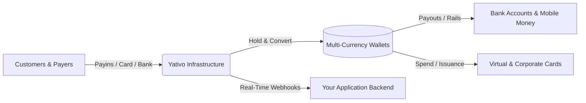

Welcome to the **Yativo Developer Documentation**. Yativo provides programmable financial infrastructure that allows businesses to collect funds globally, hold multi-currency balances, issue virtual cards and accounts, and disburse payouts across Latin America, Africa, North America, and crypto rails.

<CardGroup cols={2}>
  <Card title="Quickstart" icon="bolt" href="/yativo-platform/quickstart">
    Get your team API keys and send your first request in under 5 minutes.
  </Card>
  <Card title="Payouts API" icon="money-bill-transfer" href="/yativo-platform/money-movement/payouts">
    Send money to bank accounts and mobile wallets using local rails.
  </Card>
  <Card title="Virtual Accounts" icon="building-columns" href="/yativo-platform/cards-and-accounts/virtual-accounts">
    Issue dedicated account numbers for USD, EUR, GBP, MXN, COP, and NGN.
  </Card>
  <Card title="Webhooks" icon="webhook" href="/yativo-platform/webhooks/overview">
    Listen to real-time events for deposits, payouts, cards, and KYC updates.
  </Card>
</CardGroup>

---

## Environments & Base URLs

Yativo maintains two separate environments for integration and live money movement:

| Environment | Base URL | Usage |
|-------------|----------|-------|
| **Sandbox** | `https://smtp.yativo.com/api/v1` | Testing, simulation, development |
| **Production** | `https://api.yativo.com/api/v1` | Live money movement and settled balances |

<Note>
All API requests must be served over HTTPS. On production, API keys require **IP Whitelisting** before write requests are accepted. Sandbox requests allow testing without IP whitelist restrictions.
</Note>

---

## Core Capabilities

### 1. Money Movement
- **Payouts:** Instant or local-rail disbursements to bank accounts, mobile money, and crypto wallets. The standard payout endpoint is `POST /api/v1/payout/simple`.
- **Payins & Onramp:** Accept local currency bank transfers, mobile money, and card collections that settle directly to USD, USDC, or local currency balances.
- **FX & Locked Quotes:** Fetch real-time market rates or create locked quotes that freeze exchange rates and fee calculations.

### 2. Accounts & Cards
- **Virtual Accounts:** Generate dedicated international IBANs, ACH routing numbers, CLABE (Mexico), and NGN accounts to receive customer wire/bank transfers.
- **Virtual & Corporate Cards:** Issue Visa/Mastercard cards on demand with configurable employee limits, programmatic freeze/unfreeze, and real-time transaction hooks.
- **Merchant Card Checkout:** Offer 3D-Secure hosted credit/debit card checkout for your platform merchants and digital creators.

### 3. Enterprise Operations
- **Revenue Splitting:** Automatically split gross transactions across partner wallets and external beneficiaries with automated fee allocation.
- **Recurring Subscriptions:** Bill customer balances automatically on a recurring schedule.
- **Granular Team Access:** Manage organizations with role-based permissions (Admin, Manager, Finance, Operations, Viewer) and FIDO2 WebAuthn passkeys.

