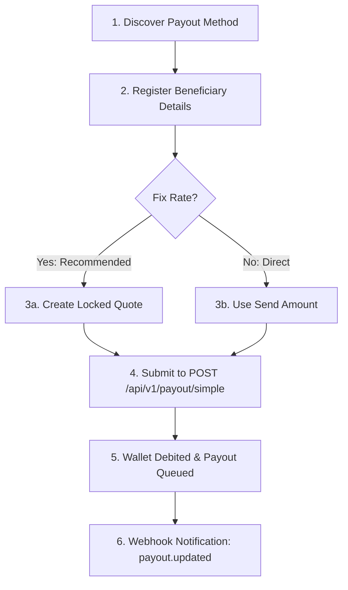

Yativo allows you to disburse funds from your multi-currency balances to bank accounts, mobile money wallets, and digital payout destinations across Latin America, North America, Africa, and crypto rails.

## Payout Endpoint

The standard endpoint for initiating single payouts is:

```http
POST /api/v1/payout/simple
```

- **Sandbox:** `https://smtp.yativo.com/api/v1/payout/simple`
- **Production:** `https://api.yativo.com/api/v1/payout/simple`

---

## Payout Lifecycle & Steps



---

## 1. Discover Payout Methods

Find available payout gateways, supported countries, limits, and required destination fields:

```http
GET /api/v1/payment-methods/payout?country=NG&currency=NGN
```

Response includes the method's `id` (to use as `gateway_id`), processing limits (`minimum_withdrawal`, `maximum_withdrawal`), and fee configuration.

### Regional Helpers (Banks & Mobile Money)

- **Nigerian Banks:** `GET /api/v1/banks/ngn` (returns bank names and codes)
- **Nigerian Account Lookup:** `POST /api/v1/banks/ngn/lookup` with `{"account_number": "0123456789", "bank_code": "058"}`
- **Mobile Money Providers:** `GET /api/v1/payout/providers?country=GH&mobile_money=true`

---

## 2. Register a Beneficiary Payout Method

Create the destination account under your beneficiary:

```http
POST /api/v1/beneficiaries/payment-methods
```

```json
{
  "beneficiary_id": 101,
  "gateway_id": 7,
  "currency": "NGN",
  "nickname": "Jane Doe - GTBank",
  "payment_data": {
    "account_number": "0123456789",
    "bank_code": "058"
  }
}
```

The response returns the created record's `id` (e.g. `18096`). This is your **`payment_method_id`**.

---

## 3. Submit the Payout

### Option A: Payout with a Quote (Recommended)

Generate a quote via `POST /api/v1/exchange-rate` or `POST /api/v1/sendmoney/quote` to freeze the exchange rate and calculate exact fees. Then submit:

```http
POST /api/v1/payout/simple
Host: smtp.yativo.com
Content-Type: application/json
X-Api-Key: yativo_pk_...
X-Api-Secret: yativo_sk_...
Idempotency-Key: 3f1c2a1e-8b7d-4c1e-9f0a-6d2b5e7c9a10
```

```json
{
  "payment_method_id": 18096,
  "debit_wallet": "USD",
  "customer_id": "d1b380e2-cbbd-4b7f-a7a9-f2d14c42f33d",
  "quote_id": "756979af-784f-4933-9ac1-76bddbeb333d"
}
```

### Option B: Direct Payout (Without Quote / Direct Send)

If you are not using a pre-calculated quote, specify the `amount` directly:

```json
{
  "payment_method_id": 18096,
  "debit_wallet": "USD",
  "customer_id": "d1b380e2-cbbd-4b7f-a7a9-f2d14c42f33d",
  "amount": 250.00
}
```

---

## Request Parameters

| Parameter | Type | Required | Description |
|-----------|------|----------|-------------|
| `payment_method_id` | integer | **Yes** | The saved beneficiary payment method ID (e.g. `18096`). Also accepts legacy alias `beneficiary_details_id`. |
| `debit_wallet` | string | **Yes** | Currency code of your wallet balance to debit (e.g. `"USD"`, `"EUR"`, `"USDC"`). |
| `customer_id` | string (UUID) | **Yes** | The UUID of the customer associated with this payout (e.g. `"d1b380e2-cbbd-4b7f-a7a9-f2d14c42f33d"`). |
| `quote_id` | string (UUID) / int | Conditional | Locked quote ID. Required if `amount` is omitted. Guarantees rate and fees for 5 minutes. |
| `amount` | number | Conditional | Amount to send from your debit wallet. Required if `quote_id` is omitted. |
| `beneficiary_id` | integer | No | ID of the parent beneficiary entity. |
| `reference` | string | No | Payment memo/reference forwarded to the recipient's bank (up to 250 characters). |
| `invoice` | file / base64 | No | Supporting invoice document (PDF, PNG, JPG up to 15 MB) for compliance screening. |
| `invoice_url` | string | No | Public HTTPS URL to the supporting invoice document. |

---

## Response Example

```json
{
  "status": "success",
  "status_code": 200,
  "message": "Payout created successfully",
  "data": {
    "id": 1845,
    "transaction_id": "WD_672a9df28a",
    "payment_method_id": 18096,
    "customer_id": "d1b380e2-cbbd-4b7f-a7a9-f2d14c42f33d",
    "debit_wallet": "USD",
    "amount": "250.00",
    "fee": "2.50",
    "total_debited": "252.50",
    "payout_currency": "NGN",
    "exchange_rate": "1650.00",
    "recipient_gets": "412500.00",
    "status": "processing",
    "reference": "INV-2026-0042",
    "created_at": "2026-11-05T12:00:00Z"
  }
}
```

---

## Batch / Bulk Payouts

To dispatch multiple payouts in a single atomic request, use the batch endpoint:

```http
POST /api/v1/payout/batch
```

```json
{
  "payouts": [
    {
      "payment_method_id": 18096,
      "amount": 250.00,
      "reference": "Batch Item 1"
    },
    {
      "payment_method_id": 18097,
      "amount": 100.00,
      "reference": "Batch Item 2"
    }
  ]
}
```

---

## Status Updates & Webhooks

Payouts transition through the following states:

| Status | Meaning |
|--------|---------|
| `pending` | Received and undergoing risk and compliance screening. |
| `processing` | Accepted by the banking rail and in transit to recipient. |
| `completed` | Funds confirmed delivered to recipient bank account or wallet. |
| `failed` | Payout failed or rejected by recipient bank. **Wallet debit is automatically refunded.** |
| `cancelled` | Cancelled by sender before bank processing. Wallet debit refunded. |

<Note>
Always listen for the `payout.updated` webhook event to update your system when the final delivery state is reached. See [Webhooks Documentation](/yativo-platform/webhooks/overview).
</Note>

